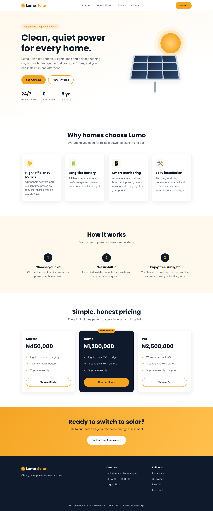
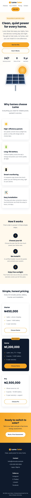

# Lumo Solar: Landing Page

**Oasis Infobyte Internship · Web Development & Designing · Level 1 · Task 1**

This is a static, responsive landing page for **Lumo Solar**, a fictional company that sells home solar kits. I built it with only HTML5 and CSS3, with no JavaScript.

## Live Demo
👉 _Add your GitHub Pages link here_

## Screenshots
| Desktop | Mobile |
|---|---|
|  |  |

## Features
- **Sticky navigation bar** with 4 links (Features, How It Works, Pricing, Contact) that stays visible while you scroll
- **Hero section** with a headline, subheadline, two call-to-action buttons and a solar-panel illustration made in CSS
- **Content sections:** Features, How It Works, Pricing and a call-to-action banner
- **Footer** with placeholder contact details and social links
- **Consistent colour palette** (navy, amber and cream) set up once as CSS variables
- **Responsive layout** built with CSS Grid and Flexbox, with breakpoints at 960px, 720px and 480px
- **No overlapping elements:** `box-sizing: border-box` is set globally, and all spacing is set on purpose
- **Typography:** Poppins for headings and Inter for body text, with a clear size scale (h1, h2, h3 and body)
- **Smooth scrolling** to each section, with an offset so the sticky nav doesn't cover the section titles

## Tech Stack
- HTML5 (semantic tags: `header`, `nav`, `main`, `section`, `article`, `footer`)
- CSS3 (custom properties, Grid, Flexbox, media queries, `clamp()`)
- Google Fonts

## How to Run
1. Clone the repository
2. Open `WebDev-L1-LandingPage/index.html` in any browser

## Author
Edward Ogheneochuko
Linkedln: https://www.linkedin.com/in/edward-ogheneochuko/
GitHub: https://github.com/edwardogheneochuko/OIBSIP.git
