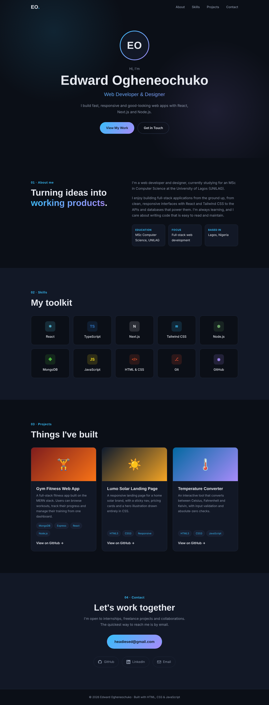
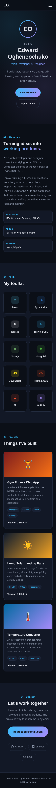

# Personal Portfolio: Edward Ogheneochuko

**Oasis Infobyte Internship · Web Development & Designing · Level 1 · Task 2**

This is a responsive, dark-themed personal portfolio that shows my background, skills, projects and contact details.

## Live Demo
👉 _Add your GitHub Pages link here_

## Screenshots
| Desktop | Mobile |
|---|---|
|  |  |

## Features
- **Hero / profile section** with my name, role title and an initials avatar
- **About Me** section covering my background (MSc Computer Science, UNILAG)
- **Skills grid** showing React, TypeScript, Next.js, Tailwind CSS, Node.js, MongoDB and more
- **Projects section** with 3 project cards, each with a title, description, tech tags and a GitHub link
- **Contact section** with my email plus GitHub and LinkedIn icon links
- **Smooth scroll navigation** using CSS `scroll-behavior`, with the active section highlighted in the nav
- **Consistent branding:** a dark theme with a sky-blue-to-violet gradient, set up once as CSS variables, plus Space Grotesk and Inter fonts
- **Fully responsive**, with a mobile hamburger menu (built with the CSS checkbox technique) and grids that collapse on smaller screens

## Tech Stack
- HTML5
- CSS3 (Grid, Flexbox, custom properties, media queries)
- Vanilla JavaScript (navbar on scroll, active link highlighting, closing the mobile menu)

## How to Run
1. Clone the repository
2. Open `WebDev-L1-PersonalPortfolio/index.html` in any browser

## Author
**Edward Ogheneochuko**: [LinkedIn](https://www.linkedin.com/in/edward-ogheneochuko/) · [GitHub](https://github.com/edwardogheneochuko)
