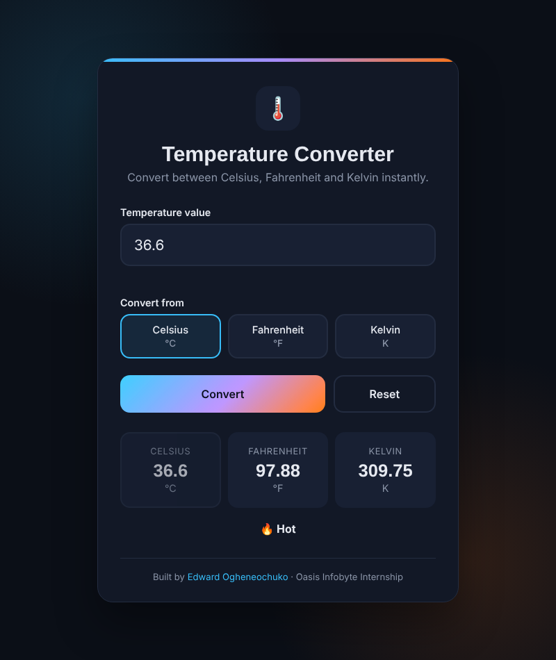
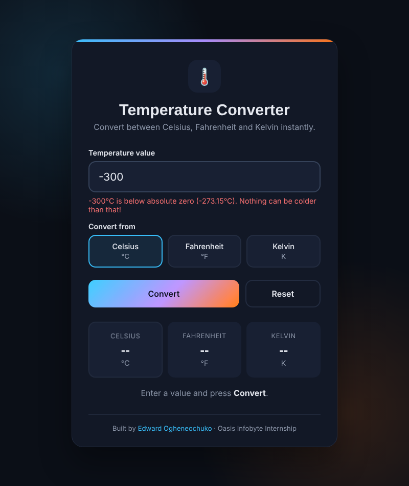

# Temperature Converter

**Oasis Infobyte Internship · Web Development & Designing · Level 1 · Task 3**

This is an interactive web tool that converts temperatures between **Celsius, Fahrenheit and Kelvin**. It validates your input and checks for impossible values below absolute zero.

## Live Demo
👉 _Add your GitHub Pages link here_

## Screenshots
| Result | Validation |
|---|---|
|  |  |

## Features
- **Numeric input with validation:** empty or non-numeric input (e.g. `abc` or `12x`) shows a clear error message
- **Input unit selector:** radio buttons for Celsius, Fahrenheit or Kelvin
- **All outputs shown at once:** one conversion displays the value in all three units
- **Convert button**, which also works when you press Enter
- **Result display** with the correct unit label for each value (°C, °F, K)
- **Absolute zero check:** values below −273.15 °C, −459.67 °F or 0 K are rejected with a friendly message
- **Reset button** to clear everything
- **Extra:** a short description of how the temperature feels (Cold, Warm, Hot...)
- **Clean, centred, responsive UI** that works on desktop and mobile

## Formulas Used
| From → To | Formula |
|---|---|
| °C → °F | `F = C × 9/5 + 32` |
| °F → °C | `C = (F − 32) × 5/9` |
| °C → K | `K = C + 273.15` |
| K → °C | `C = K − 273.15` |

Every input is first converted to Celsius, then from Celsius to the other units. This keeps the logic simple.

## Tech Stack
- HTML5
- CSS3 (Grid, custom properties, radio buttons styled as a segmented control)
- Vanilla JavaScript (`addEventListener`, regex validation, `parseFloat`)

## How to Run
1. Clone the repository
2. Open `WebDev-L1-TemperatureConverter/index.html` in any browser

## Author
**Edward Ogheneochuko**: [LinkedIn](https://www.linkedin.com/in/edward-ogheneochuko/) · [GitHub](https://github.com/edwardogheneochuko)
